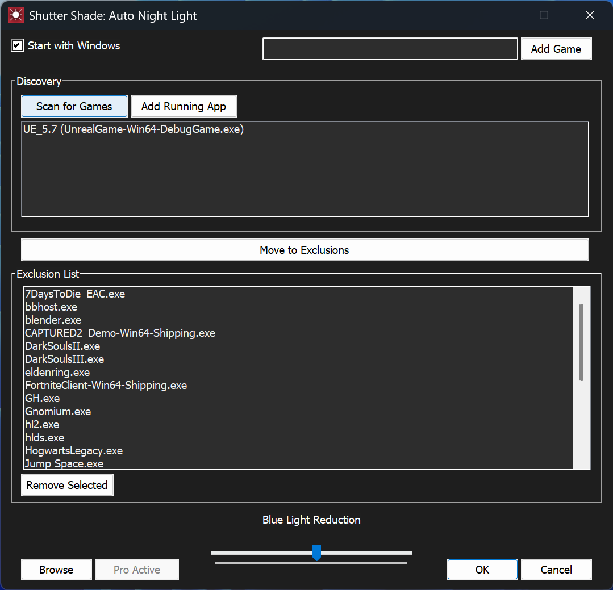
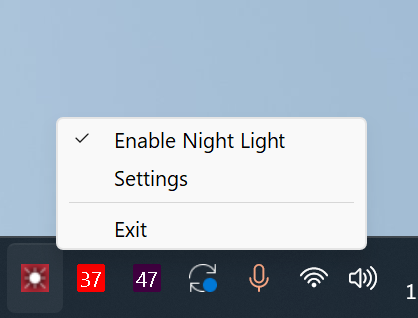

# Shutter Shade: Auto Night Light 

  
  

  <em>The primary configuration interface (Left) and system tray integration (Right).</em>

---

##  The Problem
Many gamers and creative professionals use the native Windows "Night Light" feature to reduce eye strain, but it frequently distorts colors in games or creative apps. Manually toggling system color temperatures every time you launch an application is tedious and disruptive. 

**Shutter Shade** automates this workflow, detecting your apps and games on the fly to manage display gamma ramps seamlessly without manual intervention.

---

##  Exclusive Pro Features

* **Multi-Store Game Discovery:** Automated library scanning for **Steam** (via `libraryfolders.vdf` parsing) and **Epic Games Store** (via Manifest index parsing).
* **Live-App Detection:** Instant "Add Running App" functionality utilizing Win32 process snapshots.
* **Immersive Dark Theme:** Custom `WM_CTLCOLOR` implementation for a cohesive charcoal/white UI tailored for late-night environments.
* **Smooth Gamma Transitions:** Non-linear interpolation between color states to eliminate visual "popping" when switching apps.
* **Waterfall UX:** A modernized two-pane selection layout with double-click shortcuts and multi-select handling.

---

##  Engineering & Architecture

Shutter Shade is engineered for peak performance and deep operating system integration using native Win32/C++ paradigms:

* **Robust Shell API Integration:** Utilizes `SHGetKnownFolderPath` and `SHCreateDirectoryExW` for secure path resolution, storing user data in protected local application data folders (`%LocalAppData%`) in compliance with modern Windows standards.
* **Automated Game Parsers:** Bypasses manual file browsing by directly reading and structuring registry lookups and launcher manifest metadata.
* **Throttled Configuration I/O ("Postal Delivery" Model):** To maximize SSD longevity and eliminate file-handle race conditions, configuration files are only committed to disk upon mouse release (`TB_ENDTRACK`), while GPU gamma ramp updates execute in real-time.
* **Asynchronous Threading:** Heavy file-system recursion and game library scanning are offloaded to detached background threads (`std::thread`), utilizing `PostMessage` to keep the main UI thread completely responsive and free of ghosting or hangs.
* **Graphics & Hardware Safety:** Generates 256-step WORD gamma LUT arrays backed by a strict `VerifyGammaRamp` validation check to prevent hardware-level display flickering or driver resets.
* **Modern Windows Styling:** Forces system title bars to dark mode via `DwmSetWindowAttribute` (Immersive Dark Mode) and custom subclassing for static controls.

---

##  Distribution & Licensing

Shutter Shade is published as a managed application via **AltTab Technologies LLC**, utilizing **MSIX packaging** and **Microsoft Store In-App Purchases (`StoreContext`)** for secure, friction-free license validation and durable upgrades.

---

##  Get Shutter Shade

* **[Download on the Microsoft Store](https://apps.microsoft.com/detail/9pmkz4q2lmv7?hl=en-US&gl=US)** *(Official Release)*

---
*Developed by [AltTab Technologies LLC](https://alttabtech.com)*